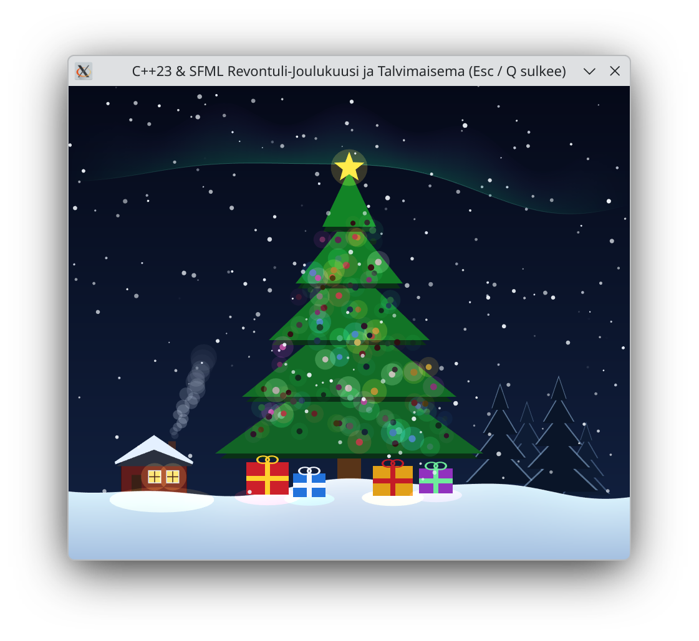

# Northern Lights Christmas Tree (Revontulikuusi)

A real-time, audio-reactive Christmas tree and Northern Lights visualizer built with **C++23** and **SFML**. The application captures system audio directly from the operating system's audio backend, performs real-time FFT spectral analysis, and drives the tree's LED lights (bass, midrange, treble) alongside a flowing aurora borealis oscilloscope across the night sky in sync with the music.

Tested and verified across three platforms: **Linux (Fedora 45)**, **macOS**, and **Windows 11**.

[](https://www.youtube.com/watch?v=PWYqN0GBeag)

> **Watch the 60 FPS Demo Video:** [Northern Lights Christmas Tree – Wham! - Last Christmas (YouTube)](https://www.youtube.com/watch?v=PWYqN0GBeag)

---

## Features

* **Real-Time 3-Band FFT Spectral Analysis:** Separates low (bass), midrange, and high (treble) frequencies into dedicated lighting channels on the tree.
* **Aurora Borealis Oscilloscope:** Renders the live audio waveform across the sky in shimmering Northern Lights colors.
* **Festive SFML Graphics:** Soft glow shaders/blending, gently falling snow, and occasional shooting stars.
* **Native Cross-Platform Audio Capture:**
  * **Linux:** PulseAudio / PipeWire (`libpulse-simple`)
  * **macOS:** CoreAudio (`AudioToolbox` / `CoreAudio`)
  * **Windows 11:** WASAPI Loopback (`ole32` / `avrt`)

---

## Requirements

* A **C++23**-compliant compiler (GCC 13+, Clang 16+ / AppleClang, or MSVC / Visual Studio 2022–2026)
* **CMake** 3.20 or newer
* **SFML 2.6.x** (`sfml-graphics`, `sfml-window`, `sfml-system`, plus `sfml-main` on Windows)

---

## Building and Running

### 1. Linux (Fedora)

```bash
sudo dnf install -y SFML-devel pulseaudio-libs-devel cmake gcc-c++

git clone [https://github.com/mikkanen/revontulikuusi.git](https://github.com/mikkanen/revontulikuusi.git)
cd revontulikuusi

cmake -B build -DCMAKE_BUILD_TYPE=Release
cmake --build build -j
./build/kuusi_revontulet
```

### 2. macOS (Homebrew)
```bash

brew install cmake sfml@2 blackhole-2ch

git clone [https://github.com/mikkanen/revontulikuusi.git](https://github.com/mikkanen/revontulikuusi.git)
cd revontulikuusi

cmake -B build -DCMAKE_PREFIX_PATH="$(brew --prefix sfml@2)" -DCMAKE_BUILD_TYPE=Release
cmake --build build -j
./build/kuusi_revontulet

```
### Windows 11 (MSYS2 UCRT64)

Option A: Visual Studio 2022 / 2026 + SFML 2.6.2 (MSVC)
```bash

git clone [https://github.com/mikkanen/revontulikuusi.git](https://github.com/mikkanen/revontulikuusi.git)
cd revontulikuusi

cmake -B build -DSFML_DIR="C:/SFML-2.6.2/lib/cmake/SFML"
cmake --build build --config Release -j
.\build\Release\kuusi_revontulet.exe

```
Option B:
```bash

pacman -S --needed mingw-w64-ucrt-x86_64-gcc mingw-w64-ucrt-x86_64-cmake mingw-w64-ucrt-x86_64-ninja mingw-w64-ucrt-x86_64-sfml git
cmake -B build -DCMAKE_BUILD_TYPE=Release
cmake --build build -j
./build/kuusi_revontulet.exe
```

Control
Esc or Q: Quit the program

### Notes:
Audio Routing on macOS (BlackHole 2ch)
Because macOS does not allow direct capture of system output audio without a virtual driver:

Open Audio MIDI Setup and click the + button in the bottom-left corner to create a Multi-Output Device.

Enable both your primary listening device (e.g., speakers or headphones) and BlackHole 2ch (check Drift Correction for BlackHole 2ch and set the sample rate to 48,000 Hz).

In System Settings → Sound, set Output to Multi-Output Device and Input to BlackHole 2ch.

Grant microphone/audio input permission to your terminal when prompted on the first run (System Settings → Privacy & Security → Microphone).


Windows 11 Audio Playback Tips
Shared Mode vs. Exclusive Mode: WASAPI Loopback captures audio from the Windows audio mixer. Make sure your media player (such as Spotify, a web browser, or JRiver Media Center) uses standard WASAPI (Shared) mode rather than WASAPI Exclusive, which bypasses the system mixer.

Bluetooth Headphones & Alternative A2DP Driver: If you use Bluetooth headphones with a third-party A2DP driver (such as Alternative A2DP Driver for LDAC/aptX HD codecs), ensure the driver's sample rate and audio profile are active and aligned with your Windows default playback device format (e.g., 48 kHz) so WASAPI Loopback receives a steady audio stream.

License
This project is licensed under the MIT License – see the LICENSE file for details.

Copyright (c) 2026 Markku Mikkanen

